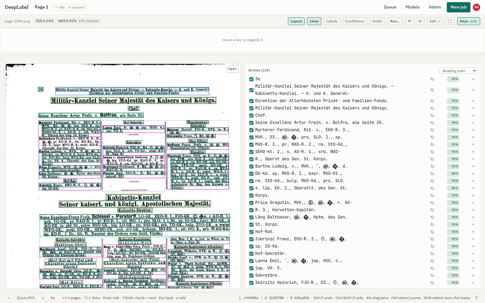

# DeepLabel

Transcription tool for scanned historical documents. Runs layout detection, line
segmentation and OCR over page scans, lets people check and correct the result, and trains
new models on the checked lines. Also annotates map tiles for segmentation.



## Architecture

| Service | Stack | Compose file |
|---|---|---|
| frontend | React + TypeScript (Vite), served by nginx, which also proxies the API | `compose.frontend.yml` |
| auth | FastAPI, Authentik (OIDC) login, sessions, roles | `compose.frontend.yml`, `compose.authentik.yml` |
| backend | FastAPI, SQLite, job queue for pipeline runs and trainings | `compose.backend.yml` |
| model backends | one HTTP server per model type, from [deeplabel-backends](https://github.com/m2key1/deeplabel-backends) | `compose.models.yml` |

Services talk only over HTTP and can run on separate hosts. The backend has no PyTorch;
models run in the model backends, which follow the contract in
[docs/MODEL-BACKENDS.md](docs/MODEL-BACKENDS.md).

## Try it without a GPU

Stub models return fixed boxes, lines and text; login is bypassed.

```bash
git clone https://github.com/m2key1/DeepLabel.git
git clone https://github.com/m2key1/deeplabel-backends.git
cd DeepLabel
docker compose -f compose.e2e.yml up -d --build   # http://localhost:8090
docker compose -f compose.e2e.yml down -v         # stop, delete data
```

`DEEPLABEL_BACKENDS_ROOT` in `.env` points elsewhere if the backends clone is not next to this one.

## Real models and production

Build the model backends (DeepOCR v3 and Kraken are ready to use), then run the backend on
a GPU host and the frontend and auth anywhere. Steps: [docs/DEPLOYMENT.md](docs/DEPLOYMENT.md).
Login setup: [AUTHENTIK.md](AUTHENTIK.md).

Configuration lives in `.env` files copied from `.env.backend.example` and
`.env.frontend.example`; every variable is explained there.

## API

Everything the UI does is available with an API token (Profile > API tokens):

```bash
curl -H "Authorization: Bearer $DEEPLABEL_TOKEN" https://<host>/api/jobs
```

OpenAPI schema at `/docs`. Python client and `deeplabel` CLI in `client/`
(`pip install -e client`), examples in [docs/API.md](docs/API.md).

## Tests

```bash
cd backend  && uv run --group dev pytest
cd auth     && uv run --group dev pytest
cd client   && uv run --group dev pytest
cd frontend && npm install && npx tsc -b && npx vitest run
cd e2e      && npm install && npx playwright install chromium && npm run e2e
```

The e2e suite starts and stops the stub stack itself; see [e2e/README.md](e2e/README.md).

## Docs

- [docs/FEATURES.md](docs/FEATURES.md) - what the app does, by area
- [docs/DEPLOYMENT.md](docs/DEPLOYMENT.md) - development, model backends, production
- [docs/MODEL-BACKENDS.md](docs/MODEL-BACKENDS.md) - the model backend contract
- [docs/API.md](docs/API.md) - tokens, client, CLI
- [CONTRIBUTING.md](CONTRIBUTING.md)

Bugs and requests: [GitHub issues](https://github.com/m2key1/DeepLabel/issues).

## License

Apache 2.0, see [LICENSE](LICENSE).
